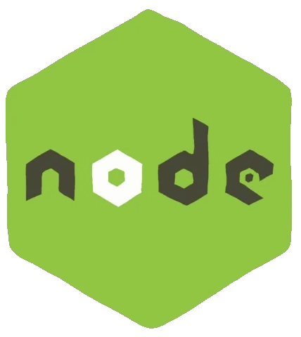
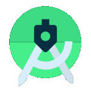

  

  <h1>Hi , I'm 𝑹𝒖𝒅𝒓𝒂 𝑾𝒂𝒈𝒉</h1>
  
<strong>Pursuing B.E. in Artificial Intelligence & Data Science (AI & DS) | First Year </strong>

  

### 💫 Learning & Focused On

- 🚀 Building scalable, production-ready full-stack applications
- ⚡ Exploring real-time systems, live data updates, and API integrations
- 🎨 Improving UI/UX and product design to build software that's both useful and intuitive
- 🧠 Exploring AI-powered applications, intelligent automation, and practical AI integrations
- 🛠️ Strengthening problem-solving, clean code practices, and software development fundamentals
- 🤝 **Open to:** Beginner-friendly open-source contributions, AI-driven projects, collaborative development, and student hackathons
 

  

<h3>Tech Stack & Skills </h3>

<strong>Languages &amp; Frameworks</strong>

  &nbsp;
  &nbsp;
  &nbsp;
  &nbsp;
  &nbsp;
  &nbsp;
  &nbsp;
  &nbsp;
  &nbsp;
  &nbsp;
  &nbsp;
  &nbsp;

  

<strong>Tools &amp; Creative Software</strong>

  &nbsp;
  &nbsp;
  &nbsp;
  &nbsp;
  &nbsp;
  &nbsp;
  &nbsp;
  &nbsp;
  &nbsp;
  &nbsp;
  &nbsp;
  

 

  

### 🌐 Connect With Me

  &nbsp;&nbsp;&nbsp;
  &nbsp;&nbsp;&nbsp;
  &nbsp;&nbsp;&nbsp;
  

  

### 📊 GitHub Stats

 
  
    
  

  

